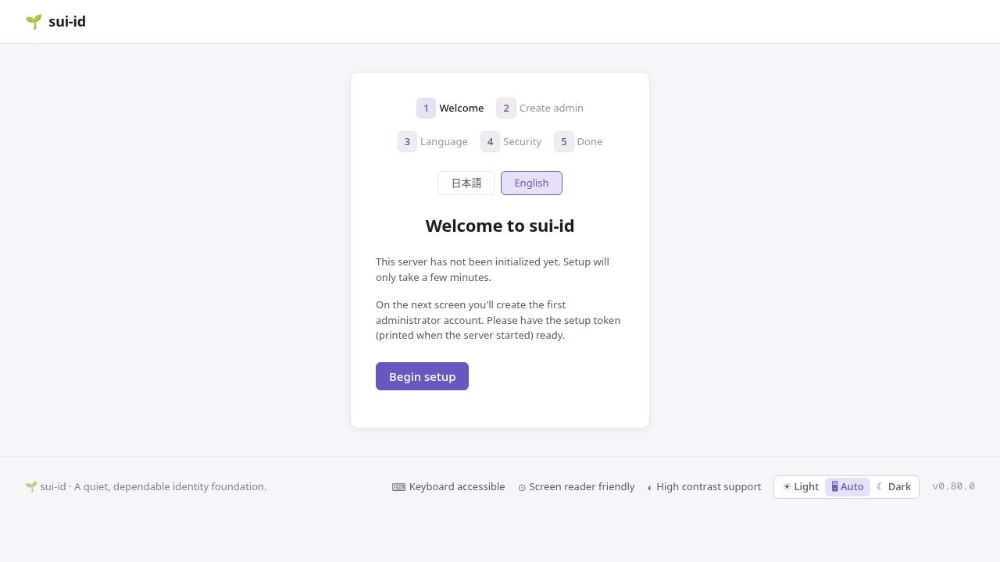

# Quick start

Pre-1.0, under active development, not yet recommended for production — see
the [FAQ](faq.md#is-sui-id-production-ready) for what that does and does not
mean.

## Install

Both commands below compile from source: you need Rust 1.95 (MSRV) — newer
than most distribution-packaged toolchains, so use
[`rustup`](https://rustup.rs/) rather than your distro's `rustc` — and the
build packages `build-essential pkg-config libssl-dev` (`libssl.so.3` is also
needed at runtime). See the [Deployment guide](../guides/deployment.md) for
the full package list.

```bash
cargo install sui-id
```

Or build from source:

```bash
git clone https://github.com/nabbisen/sui-id
cd sui-id
cargo build --release
```

## Configure

Generate a starter config:

```bash
sui-id --print-sample-config > sui-id.toml
```

Edit at minimum:

```toml
[server]
listen_addr = "127.0.0.1:8801"
issuer      = "https://id.example.com"   # must be reachable by clients
```

Leave `[storage]` alone for now — the sample config's own defaults
(`./sui-id.sqlite`, `./sui-id.key`, both in the current directory) work as
they are. The [Deployment guide](../guides/deployment.md) has the system
paths (`/var/lib/sui-id/…`, `/etc/sui-id/…`) for when you run this as a
service under a dedicated user who owns them.

## First run

```bash
sui-id --config sui-id.toml
```

On first run sui-id:

1. Creates a 32-byte master key at `key_file` with permissions `0600`.
   **Back this file up immediately.** Without it, encrypted columns cannot be read.
2. Prints a one-time **setup token** to stderr.
3. Waits at the setup wizard (`/setup`).

**Option A — headless CLI (no browser needed):**

Stop the server (Ctrl-C), then run:

```sh
sui-id setup --config ./sui-id.toml --admin-username admin
```

A random password is printed once to stdout. Then restart the server.

**Option B — browser wizard:**

Open the setup URL printed to stderr at startup
(`<issuer>/setup?token=…`). The setup token travels in that URL,
so there is nothing to type. The wizard then runs in this order:



1. **Welcome** — a landing page.
2. **Admin account** — create the first administrator.
3. **Language** — choose the default UI language.
4. **Security** — configure HIBP breach-password checking.
5. **Done** — a link to the admin dashboard.

After setup (either option), the admin panel is available at `/admin`.

## Try it locally (dev mode)

For rapid local testing, dev mode starts without a setup wizard and seeds
demo data:

```bash
sui-id --dev
```

Dev mode:
- Binds to `127.0.0.1:8801` by default.
- Seeds an admin (`admin`), two users (`alice`, `bob`) and one OIDC client from
  hardcoded defaults. No seed file is read automatically; `--dev-seed PATH`
  is the flag for one. Every `--dev-*` flag that takes a value (`--dev-seed`,
  `--dev-bind`, `--dev-db`, `--dev-admin-password`, `--dev-client-secret`) is
  honoured.
- Disables `cookie_secure` and HIBP checking. Account lockout stays active.
- Shows a **yellow banner** on every admin page as a reminder.

**Never use `--dev` in production.**

## OIDC endpoints

| Endpoint | URL |
|---|---|
| Discovery | `/.well-known/openid-configuration` |
| JWKS | `/.well-known/jwks.json` |
| Authorization | `/oauth2/authorize` |
| Token | `/oauth2/token` |
| Userinfo | `/oauth2/userinfo` |
| Revocation | `/oauth2/revoke` |
| Introspection | `/oauth2/introspect` |
| End session | `/oauth2/logout` |

For full integration details see the [OIDC API reference](../reference/oidc-api.md).

## Register your first client

A running server is not yet a connected application. Register one client so
you have something to point your app at.

1. Sign in to the admin panel (`/admin`) and go to **Clients**.
2. Under **Register a new client**, fill in an application name and at least
   one redirect URI (`https://...`, or `http://localhost:<port>/...` for
   local development). Check **Confidential client** if your app is a
   server that can hold a secret; leave it unchecked for a browser-only or
   native app.
3. Click **Register**.

sui-id shows the new client's **Client ID** and, for a confidential client,
a **client secret** — shown only once. Save both now; the secret cannot be
retrieved later, only reissued.

Your application needs four values to connect: the **issuer** (`issuer` in
your config), the **Client ID**, the **client secret** (confidential clients
only), and the **redirect URI** you just registered. Point your OIDC client
library at the issuer for discovery, and see the
[OIDC API reference](../reference/oidc-api.md) for the rest — allowed
scopes, dynamic registration, and completing the authorization code flow.
